# Outglow for Home Assistant

[](https://hacs.xyz/docs/faq/custom_repositories/)
[](https://github.com/outglow/outglow-ha/releases)
[](https://www.home-assistant.io/)
[](LICENSE)
[](https://github.com/outglow/outglow-ha/actions/workflows/ci.yml)

**Room presence from your light bulbs.** This Home Assistant integration reads the motion reports of
[Outglow](https://github.com/outglow/outglow) bulbs from Zigbee2MQTT and works out which room the movement is in. You draw
your home once (or import it from a Valetudo vacuum map), teach it with a short walk through your rooms, and get an
occupancy sensor for every room, plus a sidebar panel with a live motion map.

It is for people who already run (or plan to run) the open [Outglow firmware](https://outglow.github.io) on their
Zigbee bulbs. Bulbs with the original firmware cannot sense motion.

<p align="center">
  <picture>
    <source media="(prefers-color-scheme: dark)" srcset="docs/images/live-desktop-dark.png">
    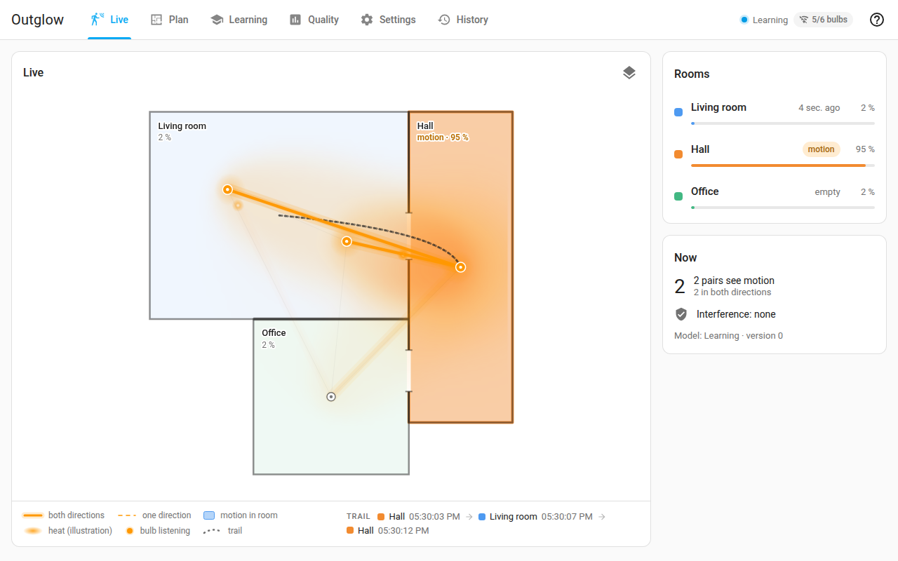
  </picture>
</p>

> [!WARNING]
> **Early version, experimental.** The integration is new and was developed with recordings from a single test home.
> It builds on motion sensing in the Outglow firmware, which is experimental too. Expect missed and false detections
> and breaking changes between releases. The pictures here come from the panel's demo mode with made-up data.

<p align="center">
  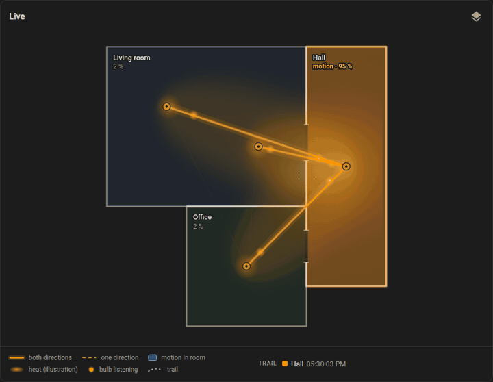
</p>

## Contents

- [What it does](#what-it-does)
- [What you need](#what-you-need)
- [Installation](#installation)
- [Getting started](#getting-started)
- [The panel](#the-panel)
- [Dashboard card](#dashboard-card)
- [Entities](#entities)
- [Actions](#actions)
- [Settings reference](#settings-reference)
- [Troubleshooting and FAQ](#troubleshooting-and-faq)
- [Privacy](#privacy)
- [Limitations](#limitations)
- [Known limitations](#known-limitations)
- [Development](#development)
- [License](#license)

## What it does

- **Motion per room.** An *Occupancy* sensor for every room on your plan, a *Motion room* sensor that names the room
  with the latest movement, and *Motion at home*. Each room has its own hold time, reaction speed and false alarm budget.
- **Decides on the host, explains with the plan.** The bulbs act as a sensitive gate; the integration compares both
  directions of every radio path, ignores interference that hits many paths at once, and asks which rooms *explain*
  the paths that see motion. A path through a wall that lights up while you move in the living room does not switch
  the hall on.
- **A floor plan.** Draw rooms, doors and walls, or import them from a [Valetudo](https://valetudo.cloud) vacuum map,
  then drag your bulbs onto it. Rooms can be resized, reshaped corner by corner, merged and nested (a pantry inside a
  kitchen), and unsaved edits survive a reload or a Home Assistant restart.
- **A learning wizard for your phone.** Walk through your rooms as it asks. The model learns how your bulbs see
  movement in your home; nothing changes until you apply what it learnt, and you can roll back.
- **Quality and history.** See how well each room is covered, which paths are noisy, what to change, and replay what
  was detected when.
- **Local and read-only by default.** Everything runs inside Home Assistant. The integration never changes a bulb
  setting unless you confirm that exact change.

## What you need

- **Home Assistant 2026.9** or newer with [HACS](https://hacs.xyz) and the **MQTT** integration connected to your broker.
- **Zigbee2MQTT** with the Outglow external converter
  ([`z2m/outglow.mjs`](https://github.com/outglow/outglow/tree/main/z2m)). ZHA is not supported.
- **Bulbs running Outglow with motion sensing switched on** (`motion_sensing` in Zigbee2MQTT): at least two that hear
  each other, and more for several rooms. Radio paths through walls do much of the work, so one bulb per room is
  usually not enough on its own. A plan holds at most 40 rooms and 100 bulbs (see [Plan limits](#plan-limits)).
- **Recommended: activity reports**, the Zigbee2MQTT device option `motion_activity_rate` above 0 (e.g. 2 per
  second). Without them the integration only sees whether each bulb detected motion, not on which paths. They need an
  Outglow firmware and converter that support them.

## Installation

### HACS (custom repository)

Outglow is not in the default HACS list yet.

[](https://my.home-assistant.io/redirect/hacs_repository/?owner=outglow&repository=outglow-ha&category=integration)

1. In Home Assistant open **HACS**, then the **⋮** menu in the top right corner, and choose **Custom repositories**.
2. Enter `https://github.com/outglow/outglow-ha`, choose the type **Integration** and click **Add**.
3. Search HACS for **Outglow**, open it and click **Download**.
4. Restart Home Assistant.

### Manual

1. Download `outglow.zip` from the [latest release](https://github.com/outglow/outglow-ha/releases).
2. Unpack it into `config/custom_components/outglow/` (the folder then holds `manifest.json` and a `frontend/` folder).
3. Restart Home Assistant.

A copy of the repository's `custom_components/outglow` folder is not enough: the panel is built from `frontend/`
during the release. To install from source, run `npm --prefix frontend ci && npm --prefix frontend run build` first.

## Getting started

### 1. Add the integration

[](https://my.home-assistant.io/redirect/config_flow_start/?domain=outglow)

**Settings → Devices & services → Add integration → Outglow.** Confirm the Zigbee2MQTT base topic (normally
`zigbee2mqtt`). The integration waits a few seconds for the bridge and then lists how many Outglow bulbs it found, in
how many motion sensing is on and in how many activity reports are on. It does not change anything in Zigbee2MQTT.
If the bridge does not answer you can still add it; it starts working when the bridge appears.

*Outglow* then appears in the sidebar (for administrators).

### 2. Draw the plan

Open **Outglow → Plan**. Draw your rooms with **Rectangle** or **Polygon**, put **Doors** on the walls between rooms,
and drag every bulb from *Not on the plan* to where it hangs. Give each room a Home Assistant area if you like, mark
the room the front door opens into, and **Save**. See [Plan editor](#plan-editor) for the details.

**Import from a Valetudo vacuum.** If a robot vacuum running Valetudo has mapped your home, choose **Import → Fetch
from the vacuum** (robots seen over MQTT are listed; otherwise type its address), or choose a map file exported from
Valetudo. Its segments become rooms with shared walls and doors, and the floor is kept as a background under the
rooms, in the editor and on **Live**. With *Keep the bulbs placed on the current plan* the bulbs you already placed
move with the rooms of the same name; that takes at least three such rooms (with one or two the bulbs stay where they
were, and the preview says how many rooms were missing). The import is only a preview until you click **Use this
plan** and **Save**. An exported Outglow plan imports the same way. A Valetudo map may be up to 16 MiB of text, an
Outglow plan up to 512 KiB, and the result must fit the [plan limits](#plan-limits).

<p align="center">
  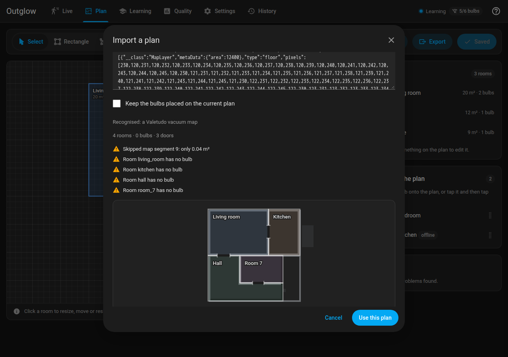
</p>

### 3. Teach it

On your phone, open the panel in the Home Assistant app and go to **Learning**. Optionally start with the home empty
for a few minutes (everyone out, so it learns what quiet looks like). Then, room by room starting from the entrance,
the wizard asks you to walk along the walls and past the door, walk freely, sit where you usually sit, and walk to the
next room. About a quarter of an hour for a small home. See [Learning wizard](#learning-wizard).

### 4. Choose rules or the model

The summary at the end shows how often each mode recognised the room you were in, before and after this session:

- **Rules** (default): a fixed rule per room, *a pair of bulbs that touches this room sees motion in both directions*.
  It needs no learning and does not change with it.
- **Bayes** (*model* in Settings): the learnt room model. It explains the paths that see motion with the fewest rooms and learns from the
  wizard, your feedback and empty-home periods. Try it once the wizard summary says it does better.

Apply the session there, or later in **Settings**. Every change of the model takes a snapshot first; **Settings →
Model** rolls back to any of them.

### 5. Tune the rooms and use the sensors

In **Settings** pick, per room, the **false alarm budget** (how many false alarms per day the night calibration aims
for), the **reaction** (fast, normal, calm) and the **hold time** (how long the room stays occupied after the last
movement). Then use the room sensors in automations:

```yaml
triggers:
  - trigger: state
    entity_id: binary_sensor.outglow_room_living_occupancy
    to: "on"
actions:
  - action: light.turn_on
    target:
      area_id: living_room
```

When it gets a room wrong, tell it: the `outglow.feedback` action (for a button or a notification) or the correction
buttons in **History** turn mistakes into labels for the model.

## The panel

Every tab has a **?** in the header that opens its section below.

### Live

The plan with the rooms coloured by how likely there is motion, the bulbs, and the pairs of bulbs that see motion right
now: a solid line when both directions agree, dashed when only one does. The trail shows the last moves between
rooms; the heat layer is an illustration, not a position. Tap a pair for both directions, their levels and thresholds
and what the pair has learnt; tap a room for its coverage and settings. **Layers** switches lines, heat, trail and
bulb names. *Now* counts the pairs that see motion and says whether interference is being ignored.

<p align="center">
  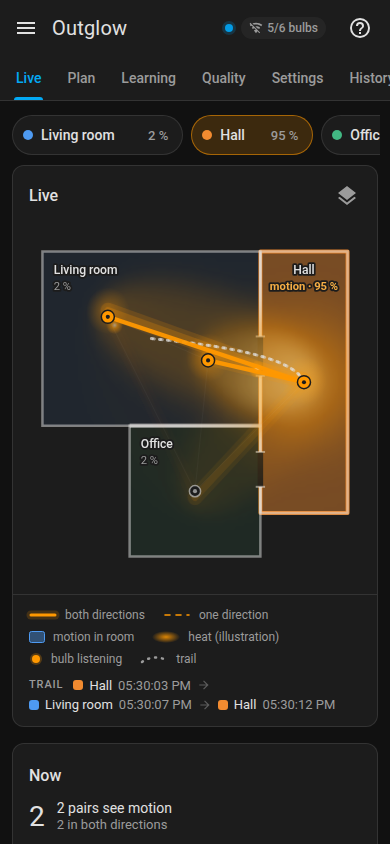
</p>

### Plan editor

Tools: **Select**, **Rectangle**, **Polygon**, **Door**, **Bulb**, undo and redo, grid and snapping, **Background**,
**Import** and **Export**. The side panel edits the selected room (name, Home Assistant area, colour, front door,
exact edge lengths), wall (kind: partition, brick, concrete, glass, no wall), door (door or opening, width, position)
or bulb (height; a bulb can be pinned to a room it does not stand in). The list of checks under it says what is still
missing, such as a room without bulbs, a bulb outside every room or rooms that overlap.

- **Stretching.** A selected room has square handles that resize it (Shift keeps the proportions, Alt resizes from the
  centre; on a phone the proportions button in the toolbar). Drag a wall to move it: a wall shared with another room
  moves in both (Alt moves only this room's), and doors on it keep their width. Drag the inside to move the room with
  its bulbs (Shift: in a straight line). Cmd/Ctrl turns snapping off; arrow keys move, Alt+arrows resize, and arrows
  stop where a wall cannot go.
- **Corners.** Drag a corner to reshape the room; double-click a wall to add a corner there. Click a corner and press
  Delete or Backspace, or double-click it, to remove it (on a phone: *Remove corner* in the panel). A corner that has
  to stay says why: a room needs three corners, and removing a corner must not make the room cross itself or run over
  another room. `,` and `.` pick the previous and next corner, `[` and `]` the previous and next wall.
- **Merging.** Select the wall between two rooms and choose *Merge into one room*: the line goes and one room is left.
  Before you save, the panel says what is lost with the removed room (its settings, its entities in Home Assistant and
  what Outglow learnt for it) and what happens to its area. Rooms that overlap, or one inside the other, cannot be
  merged, and the panel says why. *Delete* on a wall turns it into *No wall* and keeps the two rooms.
- **Nested rooms.** A room drawn wholly inside another (a pantry, a kitchen island) is nested, not an overlap: its
  walls with the outer room run along its own inner sides, you can put doors on them, and a bulb inside it belongs to
  the smaller room. Only rooms that share part of their floor are flagged as overlapping.
- **Drafts.** Unsaved edits are kept in this browser, per browser tab, for 7 days; a background from an import is
  kept with them. When the panel is rebuilt (Home Assistant restarts, or the tab was hidden for a while) or the page
  is reloaded, the editor offers to restore or discard them and says when the plan on the server has changed since.
  After a reconnect the panel fetches the plan again: without unsaved edits it is replaced, with them they stay, and
  when someone else saved meanwhile you choose *Load theirs* or *Keep mine* (which lists the rooms it would remove or
  give new ids).

<p align="center">
  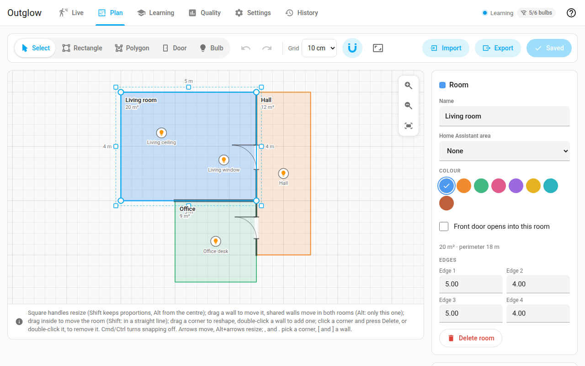
</p>
<p align="center">
  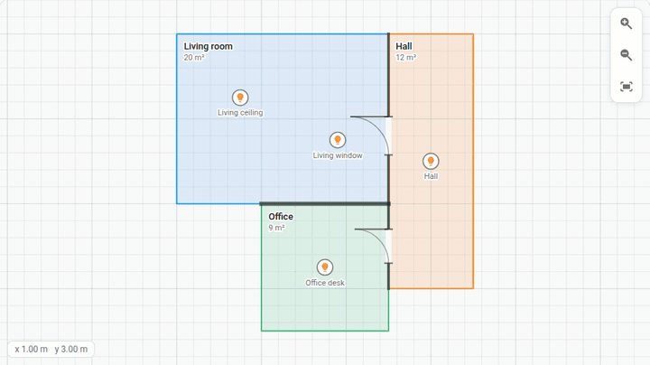
</p>

### Learning wizard

Made for a phone: big buttons, the screen stays on, it vibrates and can speak when the step changes. The check at the
start says what is missing (rooms, bulbs, motion sensing, activity reports). You can leave rooms out, choose how long
the empty-home step is, and raise the activity reports to 4 per second for the session (off by default; this writes the
`motion_activity_rate` option of every bulb in Zigbee2MQTT and is restored at the end or after 30 minutes, also after
a restart). During a step the small map shows only which lines react, not what the model thinks, so it does not steer
where you walk. What you teach stays a proposal until you apply it on the summary.

<p align="center">
  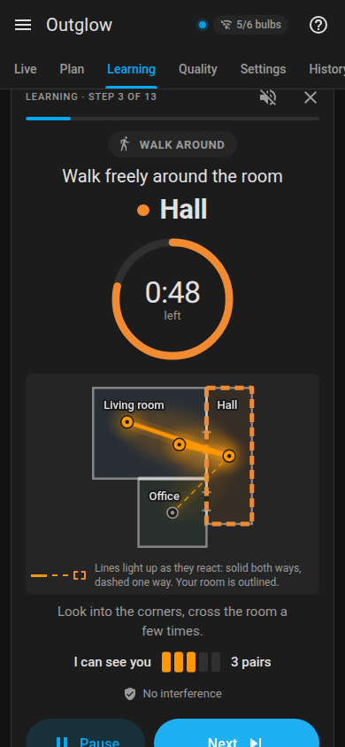
  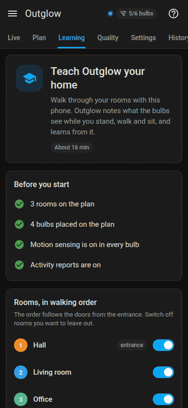
  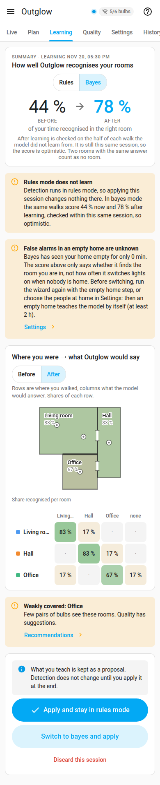
</p>

### Quality

How well each room works over the last days: false alarms per day, coverage (how much the pairs of bulbs around a room
say about it), the noisiest directions, and recommendations with the numbers behind them, for example *skip this
noisy direction*, *this room is weakly covered: a bulb here would add three paths through walls*, or *calibration
needs an empty home*. Changing a bulb's sensitivity from here always shows what it will overwrite and asks first.

<p align="center">
  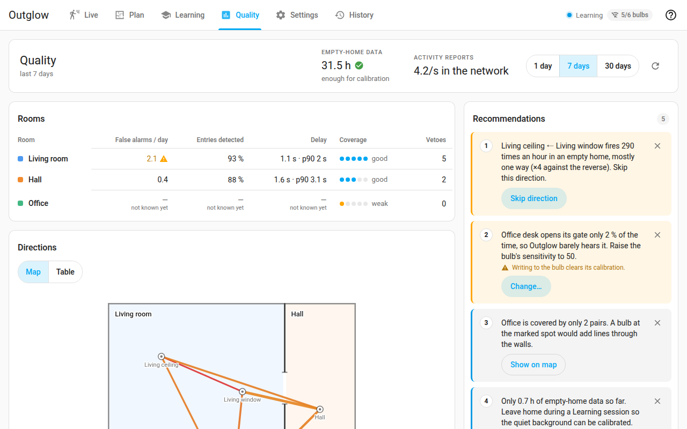
</p>

### Settings

Per room: false alarm budget, reaction and hold time, with what to expect at that budget. For the whole home: sensing
and learning on or off, rules or bayes, the people whose absence means an empty home (off by default), how long to keep
history, the model's snapshots (roll back, delete, reset learning), and the motion settings of each bulb (sensing,
sensitivity, probes, calibration). A write to a bulb is never automatic: a dialog shows exactly what it overwrites
(a new sensitivity, for example, overwrites every line of that bulb and clears its calibration) and the change goes
through only with a fresh confirmation.

<p align="center">
  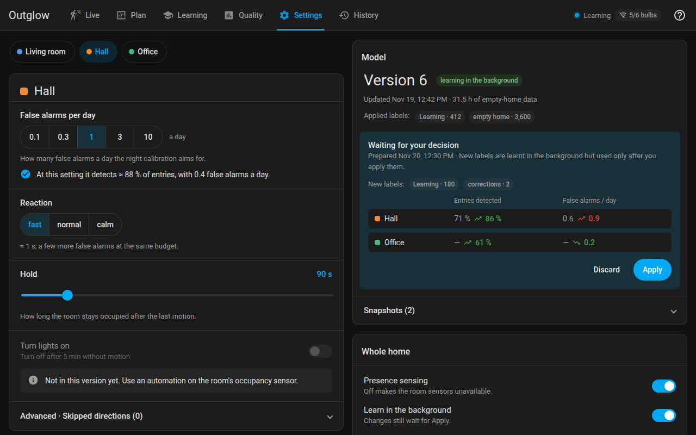
</p>

### History

A day, 6 h or 1 h of room timelines with events (motion, false alarms and misses you reported, learning, interference,
changes of bulbs and of the model). Click a moment to replay it on the plan (up to 48 h back) at 1×, 4× or 16×, and
correct it: *nobody was in the hall*, *someone was in the living room*. Corrections become labels for the model.

<p align="center">
  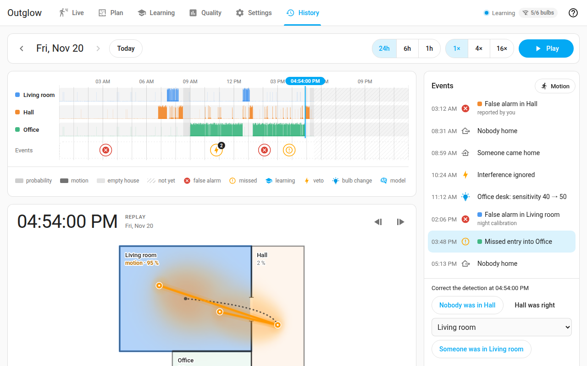
</p>

## Dashboard card

`custom:outglow-map-card` shows the live map on any dashboard. The integration registers it itself; there is no
resource to add. Pick it in the card picker or add it in YAML:

```yaml
type: custom:outglow-map-card
title: Hall & office
rooms: [hall, office]
show_heat: false
height: 260
```

<!-- generated:card -->
| Option | Type | Default | Meaning |
|---|---|---|---|
| `type` | `string` | required | `custom:outglow-map-card` |
| `title` | `string` | — | Card title; `""` hides the header. Default: Outglow |
| `rooms` | `string[]` | — | Room ids to show; default: every room of the plan |
| `show_lines` | `boolean` | `true` | Draw the pairs of bulbs that see motion |
| `show_trail` | `boolean` | `true` | Draw the trail between rooms |
| `show_heat` | `boolean` | `true` | Draw the heat layer (an illustration, not a position) |
| `show_rooms` | `boolean` | `true` | Room chips with state under the plan |
| `height` | `number` | — | Maximum height of the plan in pixels (at least 80); default 420 |
<!-- /generated:card -->

<p align="center">
  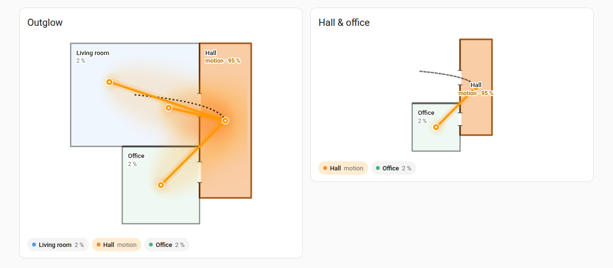
  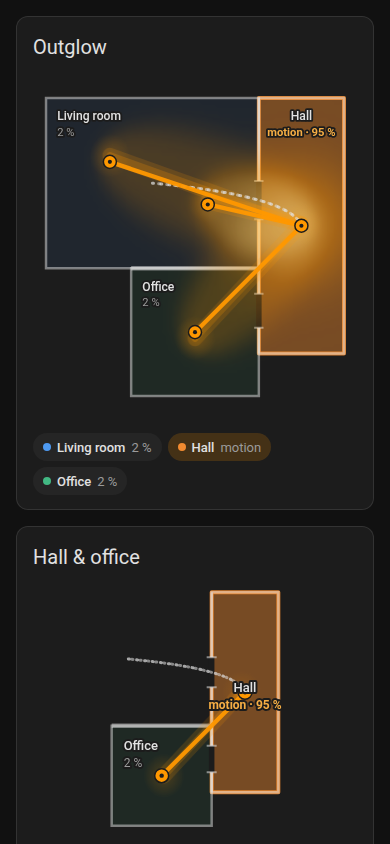
</p>

## Entities

Each room of the plan becomes a device named after the room, with the room entities below; the rest belong to the
*Outglow* device. Entity IDs keep the room id from the plan (`living`, `hall`…), so renaming a room does not break
automations.

<!-- generated:entities -->
Room entities use the room id from the plan in place of `<room>`.

| Entity | Name | Scope | Type | States | Attributes | What it means |
|---|---|---|---|---|---|---|
| `binary_sensor.outglow_home_motion` | Motion at home | home | motion | — | — | Motion in any room; turns off 10 s after the last motion. |
| `sensor.outglow_motion_room` | Motion room | home | enum | `none` | `rooms`, `trail`, `likely_person` | The room with the freshest, most certain motion, or `none`. |
| `sensor.outglow_status` | Status | home | enum, diagnostic | `learning`, `ready`, `degraded`, `paused`, `plan_too_large` | `bulbs_offline`, `last_calibration`, `model_version`, `pending`, `bulbs_active`, `bulbs_quiet`, `empty_house_hours` | Learning, ready, degraded (bulbs missing), paused, or stopped by a plan over the limits. |
| `switch.outglow_learning` | Learning | home | config | — | — | Background learning; proposals still wait for Apply in the panel. |
| `switch.outglow_sensing` | Sensing | home | config | — | — | Pauses the whole pipeline; room entities become unavailable. |
| `button.outglow_delete_motion_history` | Delete motion history | home | config | — | — | Deletes the stored motion history (SQLite) at once. |
| `binary_sensor.outglow_room_<room>_occupancy` | Occupancy | per room | occupancy | — | `motion`, `probability`, `last_motion`, `top_pairs`, `coverage`, `model_version` | On while the room has motion or is inside its hold time; unavailable when no pair covers the room. |
| `sensor.outglow_room_<room>_false_alarms_24h` | False alarms (24 h) | per room | diagnostic | — | — | False alarms in the last 24 hours (from feedback and empty-home periods). |
| `select.outglow_room_<room>_false_alarm_budget` | False alarm budget | per room | config | `0.1`, `0.3`, `1`, `3`, `10` | — | False alarms per day the night calibration aims for. |
| `select.outglow_room_<room>_reaction` | Reaction | per room | config | `fast`, `normal`, `calm` | — | How quickly a room turns on: about 1 s, 1.5-2 s or 3 s. |
| `number.outglow_room_<room>_hold_time` | Hold time | per room | config | `10-3600 s` | — | How long a room stays occupied after the last motion. |
<!-- /generated:entities -->

## Actions

<!-- generated:services -->
| Action | What it does | Fields |
|---|---|---|
| `outglow.feedback` | Tell Outglow a room's motion was a false alarm, missed or correct. | `room` (text, required): Room id or name of the plan<br>`kind` (`false_alarm` / `missed` / `correct`, required): What was wrong or right<br>`when` (datetime): Default: now |
| `outglow.label` | Label the last seconds: someone was in a room, or the home was empty. | `room` (text): Room id or name<br>`empty` (boolean, default `false`): Nobody was home<br>`activity` (`walk` / `still` / `transition`, required): What the person did<br>`duration` (1-86400 s, default `60`): Seconds back from now |
| `outglow.start_session` | Start a labelled learning session. | `name` (text): Name of the session |
| `outglow.stop_session` | Stop the running learning session. | — |
| `outglow.export_recording` | Write a JSONL recording to /config/outglow/exports. It shows who was in which room and when. | `start` (datetime, required): From<br>`end` (datetime, required): Until<br>`include_raw` (boolean, default `true`): The bulbs' reports, not only labels |
| `outglow.reset_learning` | Return the model to its priors; a snapshot is taken first. | `room` (text): Not supported yet |
| `outglow.write_bulb_setting` | Change a motion sensing setting in a bulb. A sensitivity overwrites every line of the bulb and clears its calibration. | `bulb` (text, required): IEEE address or Zigbee2MQTT name<br>`setting` (`sensing` / `sensitivity` / `probes` / `auto_calibration` / `self_tuning` / `calibrate`, required): Which setting<br>`value` (object, required): New value<br>`confirm` (boolean, required): Must be true |
<!-- /generated:services -->

`outglow.export_recording` writes a file that shows who was in which room and when; keep it to yourself.

## Settings reference

Settings are stored by the integration and edited in the panel (**Settings**); the room entities above change the
same values. The Zigbee2MQTT base topic and the log level are in the integration's options.

<!-- generated:settings -->
| Setting | Values | Default | Meaning |
|---|---|---|---|
| `rooms.<room>.false_alarm_budget` | `0.1` / `0.3` / `1` / `3` / `10` | `1.0` | False alarms per day the night calibration aims for |
| `rooms.<room>.reaction` | `"fast"` / `"normal"` / `"calm"` | `"normal"` | How many ticks of motion turn a room on: about 1 s, 1.5-2 s or 3 s |
| `rooms.<room>.hold_time_s` | integer 10-3600 | `60` | Seconds a room stays occupied after the last motion |
| `rooms.<room>.auto_light` | boolean | `false` | Reserved: switching lights is not done by this version |
| `rooms.<room>.light_off_delay_s` | integer 30-3600 | `300` | Reserved for `auto_light` |
| `global.sensing` | boolean | `true` | Whole pipeline on; off makes the room entities unavailable |
| `global.learning` | boolean | `true` | Learn in the background; proposals wait for Apply |
| `global.mode` | `"rules"` / `"bayes"` | `"rules"` | `rules` (fixed rule per room) or `bayes` (learnt room model) |
| `global.tick_s` | `0.25` / `0.5` / `1` | `0.5` | Seconds between two engine ticks |
| `global.use_persons` | boolean | `false` | Use `person` entities to detect an empty home |
| `global.persons` | list of entity ids | `[]` | Which `person` entities count for the empty home |
| `global.others_may_be_home` | boolean | `false` | Pets or guests may be home while every person is away |
| `global.quiet_background` | boolean | `false` | Also learn the background from quiet periods while people are home |
| `global.firmware_channel` | boolean | `false` | Use the bulbs' own motion bits as an extra observation |
| `global.retention.raw_h` | integer ≥ 1 | `48` | Hours of raw bulb reports kept (replay in History) |
| `global.retention.empty_raw_d` | integer ≥ 1 | `7` | Days of raw reports from empty-home periods kept (calibration) |
| `global.retention.ticks_d` | integer ≥ 1 | `14` | Days of room timelines kept |
| `global.retention.events_d` | integer ≥ 1 | `365` | Days of events kept (motion, feedback, writes to bulbs) |
<!-- /generated:settings -->

### WebSocket API

The panel talks to the integration over Home Assistant's WebSocket API; you can use the same commands.

<!-- generated:commands -->
29 commands, all for administrators only. Requests, responses and events: [docs/api.md](docs/api.md).

| Area | Commands |
|---|---|
| info | `outglow/info` |
| bulbs | `outglow/bulbs` |
| plan | `outglow/plan/get`, `outglow/plan/save`, `outglow/plan/import`, `outglow/plan/valetudo/robots`, `outglow/plan/valetudo/fetch`, `outglow/plan/background/get`, `outglow/plan/background/set` |
| live | `outglow/live/subscribe` |
| history | `outglow/history/range`, `outglow/history/frames` |
| feedback | `outglow/feedback` |
| session | `outglow/session/start`, `outglow/session/label`, `outglow/session/stop`, `outglow/session/get` |
| quality | `outglow/quality` |
| settings | `outglow/settings/get`, `outglow/settings/set` |
| model | `outglow/model/get`, `outglow/model/snapshots`, `outglow/model/apply`, `outglow/model/discard`, `outglow/model/rollback`, `outglow/model/snapshot/delete`, `outglow/model/reset` |
| bulb | `outglow/bulb/write_preview`, `outglow/bulb/write` |
<!-- /generated:commands -->

## Troubleshooting and FAQ

**The setup says Zigbee2MQTT did not answer.** Check the base topic (Zigbee2MQTT's `mqtt.base_topic`) and that
Zigbee2MQTT is running and connected to the same broker as Home Assistant. You can add Outglow anyway.

**A repair says Zigbee2MQTT sends attributes, not JSON.** Set `advanced.output` to `json` (or `attribute_and_json`)
in Zigbee2MQTT.

**A repair says the Outglow converter is missing.** The bulbs do not report `motion_links`: install
[`outglow.mjs`](https://github.com/outglow/outglow/tree/main/z2m) as an external converter and restart Zigbee2MQTT.

**No activity reports from a bulb.** Set the device option `motion_activity_rate` above 0 for that bulb in
Zigbee2MQTT (device → Settings (specific)). Without reports the integration only sees the bulb's own motion bits.

**A room is never occupied / its occupancy is unavailable.** It is not covered: no pair of bulbs sees motion there.
Rooms without bulbs are seen only by paths crossing them, and rules mode never switches them on. Put a bulb in the room
or between its neighbours, and look at **Quality** for suggestions.

**A repair says the plan is too large.** The stored plan is over the [plan limits](#plan-limits) (for example one
saved by an earlier version). Outglow keeps it but does not sense with it: the home entities are unavailable, the
status is `plan_too_large`, and learning and the night calibration wait. Open **Plan**, use fewer rooms, corners or
bulbs, or add the doors between detailed rooms, and save.

**A repair says the stored plan could not be read.** Outglow runs without rooms and leaves every room entity and
device as it is; the unreadable plan is kept as a copy in `.storage` (the repair names the file). Fix that file, or
put a copy from a backup in its place, and choose **Restore**. Or choose **Discard the old plan**, or simply draw and
save a new plan: the old rooms that are not in it are then removed with their entities, and their ids are never given
to new rooms.

**Too many false alarms.** Lower the room's false alarm budget, let the night calibration run (it needs empty-home
time: the wizard's empty step, or people entities with everyone away), skip the noisy directions that **Quality**
lists, and report false alarms with `outglow.feedback` or in **History**.

**Motion in the next room switches this one on.** Radio passes through walls. Teach both rooms in the wizard, mark the
walls' kind, and consider bayes mode, which explains such paths with the room where the motion really is.

**Does it know who is where?** No. It sees movement, not people. With people entities on and exactly one person at
home, *Motion room* adds that person as `likely_person`; nothing more.

**Does it change my bulbs or Zigbee2MQTT?** Only when you confirm a change in the panel or call
`outglow.write_bulb_setting` with `confirm: true`, and when you tick *raise activity reports* in the wizard (restored
afterwards).

## Privacy

- Everything stays in your Home Assistant: no cloud, no telemetry.
- The plan, the background picture and the history are served only over the authenticated WebSocket API, never as
  public files under `/local`. The panel and every command are for administrators only.
- History is kept in `config/outglow/history.db` for as long as the retention settings say; the
  *Delete motion history* button removes it at once.
- Diagnostics downloads replace bulb addresses with stable hashes and leave out names, plan coordinates and people.
- Motion tracking shows when someone moves in which room. Tell the people you live with.

## Limitations

- It detects **movement, not presence**: a person sitting still is invisible to the radio and is kept only by the
  room's hold time.
- Pets can trigger it, and movement next door can show up in a neighbouring room.
- One bulb in a room is usually not enough; the quality depends on where the bulbs hang, on empty-home time and on
  learning.
- One floor per plan. Only Zigbee2MQTT. Switching lights by itself (`auto_light`) is not in this version; use
  automations.
- Motion sensing in the Outglow firmware is experimental, and this integration has been tested in one home so far.

### Plan limits

So that the engine can be rebuilt in time, a plan (drawn or imported) has at most **40 rooms, 2000 room corners,
2000 walls and doors and 100 bulbs**, and the estimated cost of rebuilding the engine with the learnt model must stay
within 2 s of CPU (the rebuild runs off Home Assistant's event loop). With few rooms all 100 bulbs fit (up to 8 rooms
of four corners each); with more rooms fewer do: 89 bulbs at 12 rooms, 55 at 20, 23 at 40. A save over the limits is
refused with the limit it exceeds; a stored plan over them stops sensing until it is simplified (see the repair
above).

## Known limitations

Minor issues that are known and not fixed yet.

*Plan editor*

- The `,` `.` `[` `]` shortcuts are also matched by the physical key, so on German, French, Dvorak or Russian layouts
  the key in that place picks corners and walls too (for example `ü`, `$`, `;`, `:`), as do Shift+`,`, Option+`,` and
  a key pressed during IME composition.
- With nothing selected, the editor's hint is visible to screen readers and also announced in the status region, so
  it may be read twice.
- Merging two rooms whose Home Assistant areas were both deleted keeps the kept room's missing area, and the note
  shows it as a raw id.
- A strip that crosses the notch of a U-shaped room is reported as lying inside it, though it only crosses the notch;
  the merge is rightly refused either way.
- Undoing the addition of a selected corner moves the selection to the neighbouring corner with the same number
  instead of clearing it.
- After a browser crash or a restored session (a page closed without `pagehide`), the restored tab is taken for a
  duplicate for up to 3 minutes and gets a new tab id; the previous page's drafts are offered only by an editor opened
  after that.

*Plan, import and limits*

- An import with *Keep the bulbs* checks the limits before it adds the kept bulbs, so the preview can show more than
  100 bulbs without a warning; the save is then refused.
- The message for a plan over the CPU budget does not suggest simpler outlines or merging rooms, and suggests adding
  doors even when the rooms' adjacency is already given. The Polish repair shows the limit in English.
- When re-sending the background fails during a save, the editor stays at the old revision of the plan, and its next
  save ends in the conflict dialog.
- *Keep mine* with a large background is not handled well yet.
- With a plan over the limits the engine still loads the whole learnt model of that plan (a cost at start and in
  memory, not per tick).
- A plan listing the same bulb twice places it in one room only (the last entry wins).

*Engine and learning*

- With *Others may be home*, absence is learnt softly (CFAR background only, not the pairs' background), yet the
  wizard summary counts the empty home as known after the hours it asks for; `bayes` estimates its false alarms from
  the pairs' background, so that is optimistic.
- Turning *Use people* off during an absence, or restarting Home Assistant during one, loses the open empty-home
  interval: the night calibration does not get its raw data (what was already learnt stays).
- Making the tick longer (0.5 → 1 s) during an absence leaves about 120 s of ticks unlearnt.
- Background lessons (empty or quiet home) held while an apply derives the model go to the next proposal, not the one
  being applied (on purpose); that proposal's creation time is then the held lesson's, from before the apply. The
  list of held lessons has no bound if a derivation hangs.
- The quiet-home background (`quiet_background`) does not mark the ticks it taught, so a later empty-home label may
  teach them again.
- Ticks already taught keep that mark after a reset, a rollback or a discarded proposal, so they are not taught to
  the new model again.
- A tick topped up to full weight (0.3 + 0.7) is not counted in the label statistics of a later full-weight label.

*Panel*

- *Show on map* for a recommendation without spots hides the other candidate markers on the Quality map for 4 s.

## Development

```sh
python3.14 -m venv .venv
.venv/bin/pip install -e '.[test,lint,ha]'
npm --prefix frontend ci
make hooks          # pre-commit: README, contracts, lint, no comments, no private data
make quick          # only what the changes since main reach
make check          # contracts, README, lint, types, tests, frontend build
npm --prefix frontend run dev   # the panel on made-up data: http://localhost:5173
```

`make quick` runs only what the changes since the fork from `main` reach: ruff on the changed files, mypy, the
pytest files that import a changed module, vitest `--changed` and the Playwright specs whose view imports a
changed file (`BASE=<ref>` to compare with another point, `E2E=0` to skip the browser). `make check` runs
everything, with the 100 % engine coverage gate; run it once before a merge or a release.

The README sections marked as generated come from the code (`tools/docs.py`; `make docs` rewrites them, `--check`
fails when they are stale). The pictures come from the demo panel through Playwright (`make docs-images`, in the
Playwright Docker image so that they match CI; `npm --prefix frontend run shots -- --check` compares them). How the
engine works: [`docs/architecture.md`](docs/architecture.md); contracts and conventions:
[`docs/development.md`](docs/development.md); the WebSocket API: [`docs/api.md`](docs/api.md).

## License

GPL-3.0-or-later, like the [Outglow firmware](https://github.com/outglow/outglow). See [LICENSE](LICENSE) and
[NOTICE](NOTICE). Home Assistant, Zigbee, Zigbee2MQTT and Valetudo are trademarks of their owners; Outglow is not
affiliated with them.
